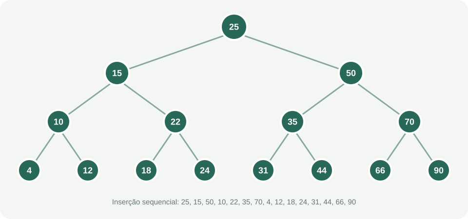

# Atividade — Árvore Binária de Busca

Aplicativo Android Studio nativo em Kotlin para inserir e buscar valores em uma árvore binária de busca (ABB). A tela inicial carrega a sequência do exercício, mostra a estrutura resultante e permite testar novas inserções e buscas.

## Integrantes

- Preencher com os nomes do grupo.

## Parte A — Implementação e estrutura da árvore

Os valores foram inseridos nesta ordem: **25, 15, 50, 10, 22, 35, 70, 4, 12, 18, 24, 31, 44, 66, 90**.

Em uma ABB, valores menores que um nó seguem para a esquerda; valores maiores seguem para a direita. Repetições são ignoradas pelo programa.

### Estrutura resultante

A tela do aplicativo também mostra essa árvore em formato textual. O diagrama acima representa o resultado das inserções sequenciais.

## Parte B — Questões de reflexão

### 1. Inserção de 40

A árvore começa vazia, então não há nó com o qual comparar. O primeiro valor vira a raiz.

~~~text
40
~~~

### 2. Inserção de 20

Começo comparando 20 com a raiz 40. Como 20 é menor, sigo para o lado esquerdo. Esse espaço está vazio, então 20 fica como filho esquerdo de 40.

~~~text
  40
 /
20
~~~

### 3. Inserção de 60

Comparo 60 com 40. Como 60 é maior, sigo para a direita da raiz. Como esse espaço está vazio, 60 fica como filho direito de 40.

~~~text
  40
 /  \
20  60
~~~

### 4. Inserção de 10

Primeiro comparo 10 com 40. Como é menor, vou para a esquerda e chego a 20. Comparo 10 com 20; como também é menor, sigo para a esquerda de 20. Esse local está vazio, então 10 é inserido ali.

~~~text
    40
   /  \
  20  60
 /
10
~~~

### 5. Como a busca navega pela árvore

A busca começa pela raiz. Em cada nó, compara o valor procurado com o valor atual:

1. Se forem iguais, o valor foi encontrado.
2. Se o valor procurado for menor, continua no filho esquerdo.
3. Se for maior, continua no filho direito.
4. Se chegar a um filho vazio sem encontrar o valor, ele não está na árvore.

O método searchPath(dado), implementado em Kotlin, registra os nós visitados. Por exemplo, na árvore do desafio, buscar 12 percorre **25 → 15 → 10 → 12**. Buscar 13 percorre **25 → 15 → 10 → 12** e termina sem encontrar o valor, pois o próximo filho à direita de 12 está vazio.

Em uma árvore razoavelmente equilibrada, cada comparação elimina uma parte da árvore, então a busca costuma ser rápida. Se a árvore ficar muito inclinada, pode ser necessário visitar muitos nós.

## Parte C — Entrega e execução

1. Abra o Android Studio e escolha **Open**.
2. Selecione a pasta binary-search-tree-android.
3. Aguarde a sincronização do Gradle.
4. Selecione ou crie um emulador Android.
5. Clique em **Run ▶**.
6. Use **Inserir** para acrescentar um inteiro, **Buscar** para testar um valor e **Restaurar valores do desafio** para voltar à sequência original.

Este README contém a atividade respondida e as instruções mínimas para executar o projeto. Preencha a seção Integrantes antes de enviar, se isso for exigido pelo professor.

## Implementação

- app/src/main/java/com/example/arvorebinariabusca/BinarySearchTree.kt — inserção, busca, percurso em ordem e formatação da árvore.
- app/src/main/java/com/example/arvorebinariabusca/TreeViewModel.kt — estado da tela e sequência inicial do desafio.
- app/src/main/java/com/example/arvorebinariabusca/MainActivity.kt — eventos da interface com View Binding.
- app/src/main/res/layout/activity_main.xml — layout da tela.
